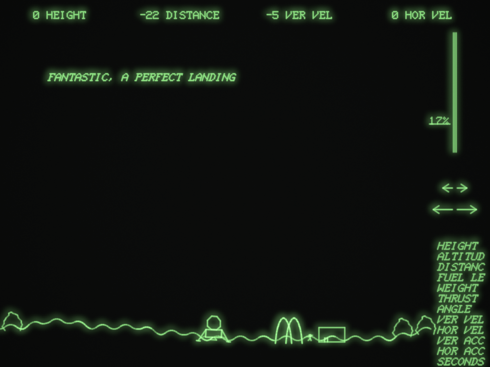

> **A fork standing on the shoulders of giants.** This began as a fork of [mctar/moonlander](https://github.com/mctar/moonlander), and we forked it for its tools: the original repository — Thordur Arnason's work — contains a model of the GT40 written from DEC's manuals — the PDP-11/05, the VT11 display processor, the console — faithful enough that the recovered Moonlander binary runs on it instruction for instruction. Everything of that machine, of the reconstruction of the program, and of the journal that records how both were made is his, and this repository carries it as it came to us. What the fork adds on top is ours: [FORTH.md](FORTH.md), a small Forth, assembled from scratch, that runs bare metal on the same emulated hardware — with a bare-metal demo, a film tool, and the desktop paths that run them — our way of showing that the machine which could fly the lunar module could also carry a high-level language, interactively, inside its 8K words. The work of the fork is also a showcase of agentic reverse coding: written, audited and fixed by various coding agents under Dagfinn Dybvig's direction, the commit history naming who did each step. The hope behind that method is larger than one language on one machine: with agents to share the painstaking work of reconstruction — reading, checking, testing, fixing, documenting — treasures of the past may be recovered that would otherwise fade from view, because such reconstruction is more than one person usually has time to do alone.

# Moonlander, recovered

Jack Burness wrote Moonlander in February 1973 for the DEC GT40, a PDP-11/05 with a vector display and a light pen, as a demonstration for trade shows. You fly a lunar module with the light pen. Point at the throttle bar to set the engine and at the arrows to turn, and land gently somewhere flat. Land beside the McDonald's and the astronaut walks over and orders two cheeseburgers and a Big Mac to go.

This repository brings back the build that survives as a binary, the one that greets you with a mission to *Mare Assabet*, as faithfully as the evidence allows. It contains:

- the program's source, reconstructed so that it assembles to the surviving binary byte for byte;
- a model of the GT40 written from DEC's manuals (the processor, the VT11 display processor, the light pen, the clock), and of its monitor's phosphor;
- a translation of the program into Rust, routine by routine, that runs in step with the original binary and has been checked against it over half a billion basic blocks;
- a desktop program that runs either one in a window, with the mouse as the light pen.



*The translation, flown by the autopilot and drawn by the models of the VT11 and its P39 phosphor. Across the top, four readouts; on the right, the throttle bar at 17%, the turning arrows, and the twelve things a readout can show. The astronaut is walking past the arches to the counter.*

The [journal](journal/) records how each part was done, what was checked and how, and what the program turned out to do that its comments don't say. It is the main document here; the rest of this page is a map.

## Running it

Ready-built copies for macOS, Windows and Linux are attached to the [releases](../../releases). They are not signed. The first time you open the Mac copy, macOS blocks it; allow it under System Settings, Privacy & Security, "Open Anyway". On Windows, SmartScreen may warn you: choose "More info", then "Run anyway".

To build it yourself you need a Rust toolchain (`rustup` gives you one). Then:

```
cargo run --release -p moonlander-desktop
```

The greeting stays up for thirty seconds before the game starts, as it did on the GT40.

| Option | |
|---|---|
| `--original` | run the original binary on the emulated processor instead of the translation |
| `--clean` | start with clean vectors instead of the phosphor |
| `--50hz` | a 50 Hz mains supply (the default is 60 Hz, as in the United States) |
| `--demo [PLAN]` | let the autopilot fly: `land`, `mcdonalds`, `flag`, `crash`, `spin` |
| `--mute` | no bell |
| `--image FILE` | *(this fork)* run an absolute loader image, such as the Forth's `forth.lda`, instead of the game |

On Linux the bell needs ALSA's development files (`libasound2-dev` on Debian and Ubuntu). To build without sound, add `--no-default-features`.

### Flying

The game reads only the light pen. The mouse is the pen: hold the button down to put it on the screen.

- **Throttle**: point at the bar on the right, at the height you want.
- **Turning**: hold the pen on an arrow. The big arrows turn faster.
- **Readouts**: point at a word in the list down the right (it starts to blink), then at one of the four readouts across the top to show it there.

The keyboard works by moving the same pen. Each key puts the pen on a control, holds it there until the program has acted, and takes it away, so the program can't tell it from a hand.

| Key | |
|---|---|
| Up, Down | throttle by 5%, or 1% with Shift |
| Left, Right | turn, faster with Shift |
| Tab | point at the next readout word (Shift+Tab goes back) |
| 1 to 4 | put it in that readout |
| V | phosphor or clean vectors |
| F | full screen |
| P | pause |
| R | load the program again |
| H | help |

The controls respond slowly, and that is the original's doing. The program acts on a control only after the pen has seen it sixteen times in a row, and the throttle reading is smoothed. If you hold the pen on the throttle for a long time, it can stop responding altogether: see `LIGHT` in [journal 008](journal/008-the-translation-and-its-proof.md). Touching any other control fixes it.

### The display

The default view models the GT40's VR14 monitor and its P39 phosphor, a long-persistence green. The beam lights each spot in proportion to how long it dwells there, the glow falls to a tenth in 150 ms (an assumption: the manual names the phosphor but gives no figure), and the spot is the size the manual gives. Nothing is drawn per window frame: the picture depends only on what the beam did and when, so blinking text fades as it did on the tube, and parts of the picture that the display processor visits less often look dimmer. Press V for clean vectors, which show the beam's recent path as plain lines.

## What is here

Everything unmarked is Thordur Arnason's, as it came from the original repository; the entries marked *(this fork)* are ours.

| Path | What it is |
|---|---|
| [`journal/`](journal/) | The working record, in order. Start here. |
| [`reference/original/`](reference/original/) | The surviving material: the 1973 listing, an RT-11 adaptation, a binary of another build whose source is lost (the Mare Assabet build, named after its greeting), and the 1969 FOCAL game it descends from. |
| [`reference/hardware-docs/`](reference/hardware-docs/) | Where to find DEC's manuals for the GT40, VT11, VR14 and PDP-11, which are not included. |
| [`docs/hardware.md`](docs/hardware.md) | The GT40 as modelled: each part, and whether each figure comes from a manual, a reading of one, or an assumption. |
| [`reconstruction/`](reconstruction/) | The reconstructed source of the Mare Assabet build, which assembles to the surviving binary exactly. |
| [`oracle/`](oracle/) | Tools used to establish ground truth: the 1973 build, the alignment of the two builds, and a processor test against simh. |
| [`crates/gt40`](crates/gt40/) | The terminal: VT11 display processor, character generator, core, line clock, host line, the CRT model. |
| [`crates/kd11b`](crates/kd11b/) | The PDP-11/05 processor (KD11-B), with instruction times from DEC's PDP-11/05 manual. |
| [`crates/moonlander`](crates/moonlander/) | The translation, its generated tables, the autopilot, and the tests that compare it with the original. |
| [`crates/desktop`](crates/desktop/) | The program you run. |
| [`FORTH.md`](FORTH.md) | *(this fork)* The Forth for the same machine: the language, a first session, the kernel from the inside. |
| [`forth.a11`](forth.a11), [`asm11.py`](asm11.py), [`build-forth.py`](build-forth.py) | *(this fork)* The Forth kernel in PDP-11 assembly, the two-pass assembler that builds it, and the built image, `forth.lda` with its listing. |
| [`crates/kd11b/examples/forthtest.rs`](crates/kd11b/examples/forthtest.rs) | *(this fork)* Boots the Forth headlessly, types lines at it, and prints the screen. |
| [`baremetal-demo.py`](baremetal-demo.py), [`demo.lda`](demo.lda) | *(this fork)* A bare-metal demo that came before the Forth: a pulsing square and a bouncing dot. |
| [`crates/moonlander/examples/film.rs`](crates/moonlander/examples/film.rs) | *(this fork)* Renders a flight to film, for shareable loops; `docs/film/` holds its edit list. |

## The journal

1. [Recovering the sources](journal/001-recovering-the-sources.md): what survives, where it came from, and the plan.
2. [The 1973 baseline, and a second Moonlander](journal/002-the-1973-baseline-and-a-second-moonlander.md): the listing rebuilt with a modern MACRO-11, and the surviving binary found to be a different build.
3. [The Mare Assabet build, change by change](journal/003-the-mare-assabet-build-change-by-change.md): aligning the binary with the listing to find every change.
4. [A matching reconstruction](journal/004-a-matching-reconstruction.md): a source that assembles to the binary exactly.
5. [The original runs](journal/005-the-original-runs.md): the processor and display processor, written from DEC's manuals, running the binary.
6. [Checking the processor](journal/006-checking-the-processor.md): the processor model against simh's, instruction by instruction.
7. [The ship's weight is an address](journal/007-the-weight-is-an-address.md): reading the program before translating it, and why the translation keeps the original memory.
8. [The translation, and checking it against the original](journal/008-the-translation-and-its-proof.md): how it was translated, how it was checked, and what it found.
9. [The terminal on a modern screen](journal/009-the-terminal-on-a-modern-screen.md): running in real time, the phosphor model, the light pen on a mouse, and the keyboard through the pen.
10. [DEC's timings](journal/010-decs-timings.md): the processor's instruction times from the PDP-11/05 manual, what the translation needed to charge them exactly, and what they change in the game.

## Checking it yourself

```
cargo test --release -p moonlander
```

runs the routine-level comparisons and the whole-program flights against the original binary on the emulated processor. The flights take about two minutes on two cores.

## Credits and licences

Moonlander is Jack Burness's. The 1973 listing has come down through Al Kossow and Eric Smith; Rick Naro collected it with the Mare Assabet binary, an RT-11 adaptation, Jim Storer's 1969 game and DEC's documentation in [sillygoose/moonlander](https://github.com/sillygoose/moonlander) (MIT licence), and John Holden supplied the binary. The VT11 character shapes are taken verbatim from open-simh's `display/vt11.c` (Philip L. Budne and Douglas A. Gwyn, MIT-style licence; the notice is kept in `crates/gt40/src/chargen.rs`). The 1973 listing was assembled with Rhialto's `macro11`, and simh served as the independent reference for the processor.

Of the work under that licence, the machine and the recovery are Thordur Arnason's — the emulator crates, the reconstruction, the oracle tools, the journal, the desktop program — as they came from the original repository. The Forth and everything it needed are this fork's, Dagfinn Dybvig's: the kernel, the assembler and the builder, the headless test, the bare-metal demo, the film tool, and the desktop's `--image` path and keyboard console. The fork's work was done by various coding agents, with Dybvig directing — deliberately, as a demonstration of agentic reverse coding on a machine recovered by hand; the commits name the author of each piece. Both are under the MIT licence ([`LICENSE`](LICENSE)). Moonlander itself is not: the reconstructed source and the translation are versions of Burness's program, and the material above keeps its own terms. DEC's manuals are not included; [`reference/hardware-docs/`](reference/hardware-docs/) says where to find them.
