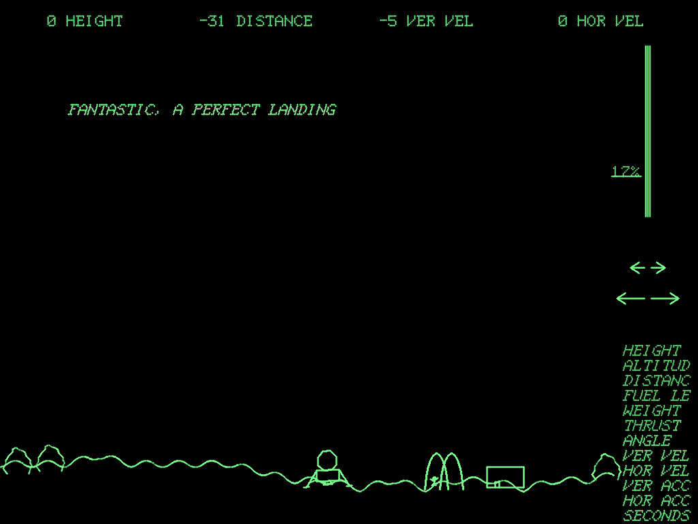
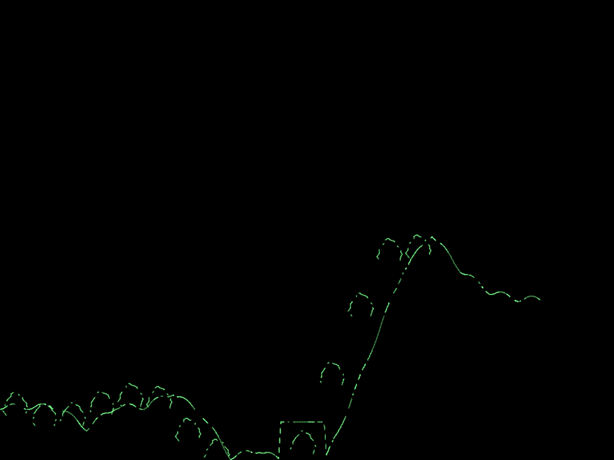

# 008 The translation, and checking it against the original

Date: 2026-10-14

The program is now translated into Rust (`crates/moonlander`), all 608 basic blocks of it, and checked against the original binary running in the emulator. This entry describes how the translation is built, how it is checked, what the checking caught, and what the program turned out to do that its comments do not say.



*The translation running, drawn by the VT11 model: a perfect landing by the autopilot described below, the readouts across the top, the throttle bar at 17%, the turning arrows and the readout choices on the right, and the man on his way to the McDonald's.*

## How it is translated

Entry 007 set the design, because the program keeps state outside its variables:

- **Memory.** The translation runs on the original 8K-word memory image, with the same layout, loaded from the assembled reconstruction. Variables, tables, display lists, and the instruction words that double as data all sit where they did. The VT11 model draws the picture from that memory by DMA, as the real one did.
- **Registers and stack.** The six general registers keep Burness's names (`in1`, `in2`, `ret1`, `ret2`, `temp`, `temp2`). Calls push the original return addresses onto a stack in that memory.
- **Time.** Each routine is written in the basic blocks of the original. At the start of each block it calls `at(BLOCK)`. That call charges the time of the block before it, instruction by instruction, takes any interrupt that is due, and reports the block to an observer if one is attached.

The tables behind this are generated, not written by hand. `crates/moonlander/gen/gen.py` reads the assembler's listing, decodes every instruction from the image, and splits the program into blocks. A block starts at each label, after each transfer of control, and at each instruction that touches the I/O page. For each instruction it computes the time with the KD11-B model, by running the instruction once in a sandbox machine. The output is 608 named block constants, each documented with its original source lines; 560 symbols; and the image.

A short routine, the clock interrupt, original and translation:

```
TIMER:  BIS     #100,LKS                ;JUST MAKE SURE CLOCK IS STILL GOING.
        INC     TICKS                   ;UPDATE CLOCKS.
        INC     TIME                    ;INCREMENT BOTH CLOCKS.
        BIT     #17,TIME                ;SEE IF IT'S TIME TO CLEAR ARROWS.
        BNE     TIMERT                  ;NOPE. EXIT.
        CLR     DLIST1                  ;YES. CLEAR THEM.
        CLR     DLIST2
TIMERT: RTI                             ;AND RETURN NOW.
```

```rust
pub(crate) fn timer(&mut self) -> Flow {
    self.at(blk::TIMER)?;
    let v = self.w(LKS) | 0o100; // JUST MAKE SURE CLOCK IS STILL GOING.
    self.set(LKS, v);
    let ticks = self.w(TICKS).wrapping_add(1); // UPDATE CLOCKS.
    self.set(TICKS, ticks);
    let time = self.w(TIME).wrapping_add(1);
    self.set(TIME, time);
    if time & 0o17 == 0 {
        // TIME TO CLEAR ARROWS: every 16 ticks the brightened arrow
        // goes back to normal.
        self.at(blk::TIMER_1)?;
        self.set(DLIST1, 0);
        self.set(DLIST2, 0);
    }
    self.at(blk::TIMERT) // RTI
}
```

The parts that are not plain code are translated literally:

- **Self-modifying code.** `DRAW22` runs whichever of `INC` and `DEC` its instruction word currently holds. `PALSYI` runs the instruction `MOVMAN` wrote there.
- **Flags inside instructions.** `MACON` and `MACTHR` are read and written where they sit, as the operands of instructions.
- **`MOV PC,(SP)`** stores the address the original would have stored.
- **The stack tricks.** `DRAWMC` returns through `JMP @10.(SP)`, leaving its return address under the registers it saved. `DEADSP` reads its arguments through its return address and then drops the call.
- **Jumps out of nested calls.** `JMP RESTART` and `PALMX2`'s reset of the stack pointer become early returns that unwind to the top.
- **One branch on stale condition codes.** `GODEAD` is a label on a `BLE`, so the comparison it branches on depends on how it was reached. It becomes a function that takes the condition as an argument.

The translation keeps no condition codes between blocks: each branch tests the value it depends on.

## How it is checked

### The same machine on both sides

Everything except the processor (core memory, the VT11, the line clock, the host line and the keyboard) is now one component, `gt40::terminal::Terminal`. The emulator runs the original binary on it, and the translation runs on the same code. A difference between the two can therefore only come from the program, or from where the two processors let the terminal run.

That second source is closed with a comparison mode in the emulator, the **block-synchronous mode**. In it, the emulator brings the devices up to time and takes interrupts only when its PC is at the start of a block, as the translation does. It also writes stacked PSWs with their condition codes cleared, because the translation keeps none, and has RTI restore the real codes from a shadow copy. The original program therefore runs exactly as it otherwise would, and the two sides leave identical words on the stack.

Time is compared exactly, not within a tolerance. The emulator adds each instruction's time to a floating-point clock. The translation adds the same values, generated from the same model, in the same order, so the two clocks agree to the last bit.

### One routine at a time

`tests/arith.rs` and `tests/routines.rs` run single routines with interrupts held off, from the same state on both sides. Each run must leave the same blocks visited in the same order, the same registers, the same machine time and the same 8K words of memory. The inputs are random within what the program can produce, plus the edges: overflowing divisions, angles a long way round, every readout and number width, every part of the close-up. That is about 20,000 cases, over fourteen routines called directly and the ones they call.

To check the check, I injected two faults into a translated routine: a flipped register bit, and a timing error of a billionth of a microsecond. The comparison caught both.

### The whole program, in lockstep

`tests/lockstep.rs` runs the original and the translation from power-up, side by side, with interrupts live. At every block start the two must agree on the address, the machine time, the six registers and the stack pointer, the processor priority, a hash of all of memory, and where the display processor is (its program counter, beam position and clock). The first disagreement stops the run, with the block before it and a list of differing memory words.

To fly the game, `moonlander::pilot` holds the light pen over the throttle bar and the turning arrows, as a player did. It reads the program's variables, decides where the pen should be, and schedules each move for a moment just ahead. The same moves go to the original. It has plans for perfect, good, rough and crippling landings, braking hard over dust, tipping over with sideways speed or tilt or on steep ground both ways, landing by the McDonald's and flying into it, planting a flag, climbing off the top, drifting off either edge, flying low across the close-up, spinning, and choosing a readout. *Console deposits* on the terminal, timed writes made at the same point on both sides, set up what earlier games would have left: an old flag, a landed ship and two wrecks, low fuel, raised ground. One flight runs with no host line.

There are 25 flights in all. **539,020,449 blocks ran in lockstep, with no difference.**

### What the comparisons caught

Two faults, neither in Burness's program and only one in the translation:

1. **In the translation.** When an interrupt woke the processor from `WAIT`, it stacked the address of the `WAIT` instead of the address after it. This was the first lockstep difference, about a tenth of a second into the first run.
2. **In the display model.** A light pen movement scheduled while the display was stopped took effect when the display next ran, not at its own moment. Two runs given the same movements therefore saw the pen in different places. The VT11 model now looks up where the pen is by the time of each point it draws.

### Coverage

The flights reach 590 of the 608 blocks, and the single-routine tests reach five more. The other 13:

- **The ten fault handlers.** The trap catchers, the power-fail routine and the display bus error routine, which run only on hardware faults.
- **`DRAWI1_1`, which cannot run.** See *craters* below.
- **`PALNOR_2`, which in practice never runs.** See *the man always walks right* below.
- **`TILT2_1`**, one instruction, which runs when a ship tips over onto ground rising steeply to the right. None of the flights did that.

## What the program does that its comments do not say

Entry 007 recorded that acceleration is divided by a table address, not the weight. These further behaviours turned up while translating and flying; each is in the original binary, since the translation runs block for block with it.

| Where | What happens |
|---|---|
| `LIGHT`, `LIGHTG` | A control acts after 16 consecutive light pen hits, counted down in `HITCNT`. Nothing stops the count, and after 32,768 hits it wraps from -32,768 to +32,767. The control then ignores the pen until it has counted back down. With the pen held on the throttle, in this display model that is about 15 seconds of control, then about 90 seconds of none, unless the pen touches something else and resets the count. The rates depend on the light pen model; the wrap does not. |
| `WHERE` | Velocity changes are acceleration × ticks / 3000, and the remainder is thrown away (positions keep theirs). With `CLOCK` at 5, a net acceleration under 1.2 ft/s² never changes the speed, so the ship coasts at a constant rate over a band of throttle settings around hover. How wide the band is depends on how many ticks each step takes, so on the processor's speed. |
| `OFFTOP` | Flying off the top resets the ship's horizontal position from what the comment calls "PRESENT X VALUE", but the register holds the altitude, so the ship reappears at a distance worked out from its height. |
| `DEADSP` | Wrecks and landed ships from earlier games are drawn into the close-up's 1,000-word list. If it is nearly full, `DEADSP` returns into its own parameter words and the processor executes them. For an upright ship that is a `HALT`. For one tilted left it is a floating point instruction the 11/05 lacks, which traps and halts. For one tilted right it is `JMP @(R2)+`, a jump to an address taken from the terrain table. |
| `DRAWIC` | A close-up point below the bottom of the screen should be clamped to the bottom, but the first test is an unsigned `CMP TEMP,#1024` / `BLO`, so a negative height counts as above the top. The line then climbs towards the top in 6-bit steps, which go nowhere once the distance is a multiple of 64. Deep craters therefore draw as flat-topped boxes standing up from the ground (picture below), and the code meant for points below the screen cannot be reached. |
| `PALSY`, `PALNOR` | The direction the man walks is meant to come from the low bit of `TIME` ("FUDGE WHICH WAY TO MOV THE MAN"). Just before, `PALSY1` waits for `TIME` to reach a multiple of 128, and the next tick is 16 ms away. So the bit is always 0, and the man always walks right. |
| `GODEAD` | Not a bug: a label on a branch instruction, entered by branches whose condition is already known to be true and by falling through from a comparison of its own. |



*The close-up drawn from index 585, alone, without the display subroutines it calls. The ground falls into the crater at 594, deeper than the bottom of the screen, and is drawn as the box at the bottom centre instead. The arches are rocks.*

## Limits

- **Interrupt timing.** The equivalence holds under one rule: interrupts are taken at block starts. A real GT40 takes them between any two instructions, so the original on real hardware can service an interrupt up to one block (a few tens of microseconds) earlier than either side here. Within a run that moves when display restarts happen; it does not change what any routine computes.
- **Condition codes on the stack.** Stacked PSWs carry no condition codes in the translation. The only reader of stale stack words is `EXGEN`'s `-6(SP)`, which uses them as noise for the explosion.
- **Timing model.** The KD11-B timing model is still the provisional one. When the 11/05 manual's tables replace it, `gen.py` regenerates the block times and the tests rerun unchanged; the speed of each step, and with it the coasting band above, will change.
- **The light pen.** How many hits a held pen produces is a property of the VT11 model's pen, whose field of view and recovery time are modelled from the manual and not measured.
