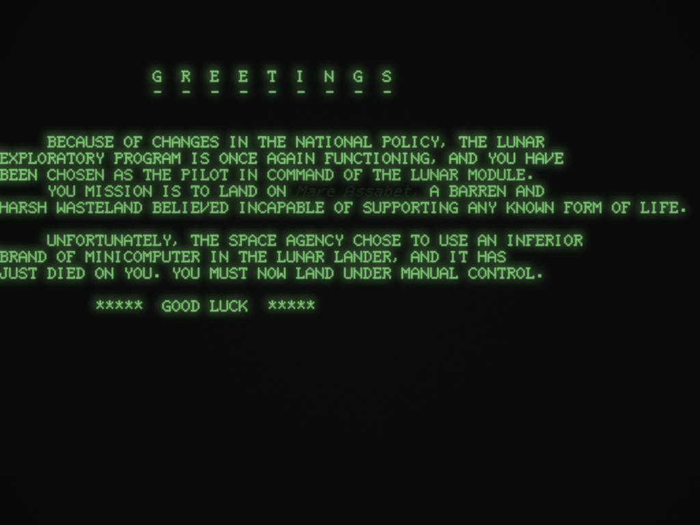
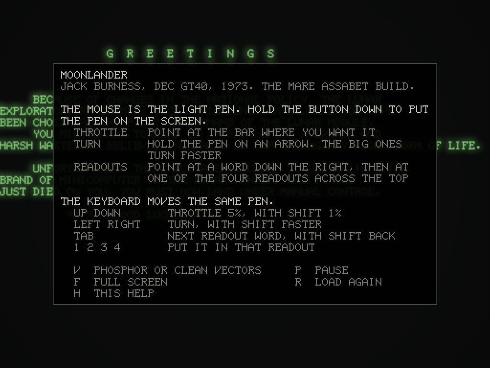

# 009 The terminal on a modern screen

Date: 2026-10-14

Entries 005 to 008 built the machine and the program and checked them against each other. This entry is about what a person sees and touches: the window, the tube and the light pen. The program is `crates/desktop` (it builds as `moonlander`), and the tube is `gt40::crt`.

*The greeting, thirty seconds before the game starts, on the modelled P39 phosphor. "Mare Assabet" blinks; here it is fading through the off half of its blink.*

## Running in real time

The program runs on its own thread, on the same terminal model as everywhere else. Its clock is machine time, which only the program's instructions advance. The host compares that clock with the wall clock about once a millisecond of machine time: when the machine is ahead it sleeps, and if it has fallen more than a tenth of a second behind (the computer slept, say) it starts counting again from where it is, instead of racing to catch up.

Since everything the program does depends only on machine time, running in real time changes when things appear on the screen, never what they are. In the window, the screen 36 seconds after start showed 18766 feet of height and -16657 feet of distance, the same digits as the offline run at 36 seconds.

`--original` runs the original binary on the emulated processor instead, in its ordinary mode, which takes interrupts between any two instructions as the real 11/05 did.

## The tube

The GT40 user's guide gives the monitor's phosphor as P39, a viewable area of 9 by 6.75 inches, and a spot size of "< 20 mils inside the usable screen area at a brightness of 30 fL [Full Width at Half Maximum (FWHM)]". The 1024 raster units across the face make a unit 8.8 mils, so the spot is under 2.3 units across. The model uses a Gaussian spot 2.0 units across at half maximum.

The model keeps the phosphor's excitation per pixel. Each beam event from the VT11 model adds to it in proportion to how long the beam dwelt on each pixel and to the intensity level, and the excitation decays exponentially with machine time. The manual gives no persistence, and the sources I could reach call P39 "long" without a figure, so the decay, to 10% in 150 ms, is an assumption. The brightness curve, the strength of the faceplate glow and the relative brightness of the eight intensity levels are set by eye.

Two properties come from the way it is built rather than from tuning:

- **It does not depend on the window.** The spot and the glow are sized in raster units and brightness follows excitation per unit area of the face, so the picture is the same in a small window, a full screen, or on a high-density display. Nothing is decided per frame of the window: the window only asks what the phosphor looks like at a given machine time.
- **It shows what the beam did.** The VT11 draws a vector in a time set by the next power of two above its length (manual section 2.2.10.3), so a vector 513 units long dwells twice as long on each unit as one 1,023 long, and is brighter. A blinking item fades through its off phase instead of vanishing. A readout whose digits are changing shows the old digits fading under the new ones. Parts of the picture that the display processor visits less often are dimmer, which leads to the next section.

## Clean vectors, and an uneven refresh

The other view, clean vectors, shows the beam's recent path as plain lines. The first version drew the beams of the last 25 ms, on the reasoning that the display comes round every 8 ms or so. It did not hold: after a few seconds with the pen on the throttle, the ground in the high view broke into dashes.

Measured on the translation 34 seconds into a flight, the median time before an identical vector is drawn again is 8.4 ms with no pen, and 12.5 ms with the pen held on the throttle bar. But some stretches of the ground came round much less often: with the same flight, a 40 ms window still showed gaps, and a 60 ms window showed none.

The reason the refresh can be uneven is in the program. The display file calls its subroutines through the processor: each call and each return stops the display and raises an interrupt, and `DISPLY` works out where to go and starts the display again. Each light pen hit also stops the display, until `LIGHT` resumes it at `LPRESM`. So the display waits on the processor, and is slower whenever the processor is slow to answer. I have not traced which waits make the 40 to 60 ms gaps.

The clean view now shows each beam at full strength for 20 ms and fades it out by 70 ms. Parts redrawn less often show slightly dimmer, as they do on the phosphor.

The first screenshot from a Mac showed a fault the Linux tests had not: faint rings centred on the face. The faceplate is lit very dimly, a little brighter at the centre, and in 8 bits that slope crosses only three or four output levels, so it came out as bands, each a different tint because the three colour channels step at different radii. The output is now dithered with a fixed pattern of noise of at most one level either way, the same on all three channels, and the rings are gone even with the contrast raised 25 times.

## The light pen

The mouse is the pen: while the button is down, the pen is on the face under the cursor, and the VT11 model sees whatever the beam draws within its field of view. The field of view, 5 raster units in radius, is the one the autopilot uses; like the pen's recovery time, it is modelled from the manual, not measured. A faint ring shows where the pen is.

## The keyboard, through the pen

The program reads nothing but the pen, so the keyboard does not talk to the program. Each key moves the pen to a control, holds it there until the program has acted, and takes it away, using the control positions the autopilot uses:

- **Turning** holds the pen on an arrow while the key is held.
- **A readout** holds the pen on one of the twelve words until `LPFLG1` changes, which is when the program has taken it up and set it blinking; a slot is held until the blinking word has been put there.
- **The throttle** holds the pen on the bar until the percentage shown is the one asked for.

The throttle needed more than a position. `LPBARH` averages where on the bar the pen saw the beam, so the reading depends on the pen as well as on where it points. Measured with this pen model, the reading settles at about (Y - 466) / 2 percent whichever way it comes from: a pen at Y = 522 gives 28%, at 600 gives 67%, at 652 gives 93%. The autopilot's comment had (Y - 462) / 2, which made no difference to it, since it steers by the reading; the comment is corrected. The keyboard does what a hand would: it points, watches the percentage, and moves the pen up or down every 40 ms until the percentage is right. A test presses +5, +5, -1, -50, -50 and +20 from the starting 75% and checks the readings that follow: 80, 85, 84, 34, 10 (the floor) and 30.

Because the keyboard goes through the pen, the program's own behaviour applies to it too, including the `HITCNT` wrap in entry 008. Turning resets the count, so in practice a keyboard player meets it only by pressing the throttle keys for a long time without turning.

## The bell

The GT40 manual: "If an attempt is made to write to address 172002, the effect is to ring the BELL in the GT40/42". Moonlander rings it twice: once when the fuel falls under 200 pounds (`BIS #0,DSR ;AND RING THE BELL <ONCE ONLY>`) and when the ship explodes (`EXPLOD`). The manual describes the bell only as a "tone generator", so the sound, 150 ms of a soft 880 Hz tone, is a guess.

## Limits

- **The phosphor.** Only the spot size comes from a document. The persistence is an assumption, and the rest is judged by eye.
- **The pen.** How many hits a held pen produces, and so how quickly the controls respond, is a property of the modelled pen.
- **The host.** The window draws at 60 frames a second without waiting for the display's vertical blank. The front end was tested on Linux, under a virtual X display, by sending it keys and mouse movements and photographing the screen, and has since run on a Mac with a high-density display. It has not been run on Windows.
